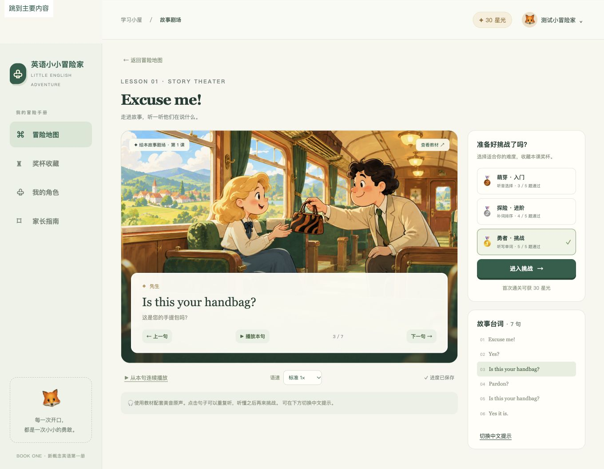

# 验证报告

日期：2026-10-22。环境：macOS arm64、项目专用 Go 1.27.3、Node 20.14、Python 3.8。

## 自动化

- `go test -race ./...` 通过：角色隔离、原子持久化及失败回滚、重启恢复、判分门槛、领奖幂等、非法请求、音频 Range、全册 144 × 3 难度题目生成、答案不泄露、家庭访问密码。
- `go vet ./...` 通过。
- `node --test web/*.test.js`：4 项通过，覆盖字幕边界、迟到测验响应、角色/页面切换、提交后立即关闭弹窗的奖励刷新。
- `node --check web/app.js` 通过。
- `python3 scripts/test_content.py` 通过：144 个连续课次、72 组音频、时间轴、教材页、偶数课配对及独立标题。
- `bash -n scripts/fetch_assets.sh start.sh` 与容器入口 `sh -n` 通过。
- 在全新隔离安装目录执行 `scripts/fetch_assets.sh`，从 GitHub 获取固定版本素材后，144 课/72 组音频完整性检查通过。
- `CGO_ENABLED=0 GOOS=linux GOARCH=amd64 go build ./cmd/server` 通过。

## 浏览器验收

在独立 QA 服务 `127.0.0.1:8081` 与 `tmp/qa-save.json` 上执行，不使用正式家庭存档。

1. 创建“测试小冒险家”，进入第一课，播放原声、切换句子。
2. 完成最高难度 5/5，获得金杯及 30 星光。
3. 刷新页面和重启后端后，角色、金杯、星光及学习位置保留。
4. 检查第十二章和第 144 课，教材页与配对第 143 课录音说明正确。
5. 手机 390px 宽度无水平溢出；桌面对话页截图见下图。
6. 浏览器验收过程中未报告 JavaScript 错误。

## 审查与修复

独立代码审查发现了请求迟到导致旧页面重绘、关闭提交弹窗后奖杯暂不刷新两个问题。均新增可重现失败的行为测试，修复后全部通过，详见变更记录 008/010。

## 未验证与内容限制

- 未执行 Docker 构建、真实云部署、跨公网 HTTPS/密码/持久化磁盘验收；当前机器没有 Docker，部署目标尚待选择。
- 未对全册 1226 条源字幕逐句人工听校；仅第一课有人工中文释义、人物标注和彩色重绘。
- 其他课程展示已匹配的扫描页；偶数课复用对应奇数课音频，挑战为基于台词的派生练习。
- 自动测试覆盖题目生成结构和答案判分，不能代替逐课教学内容审定。
